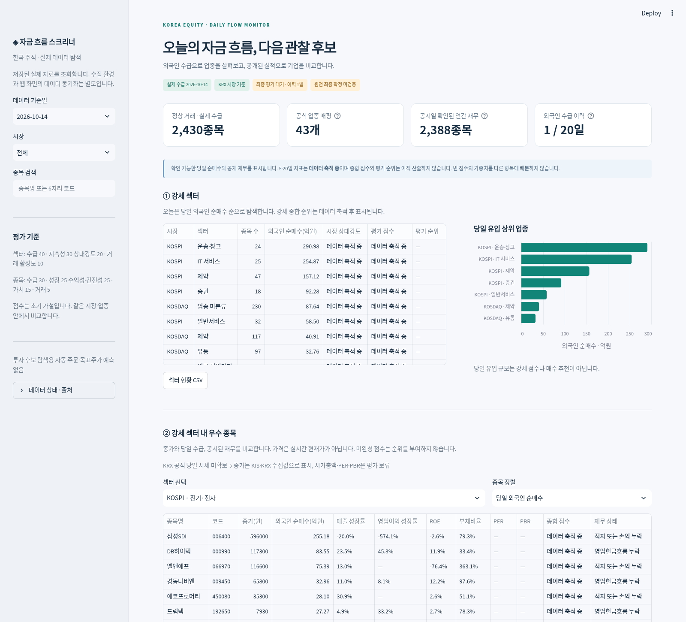
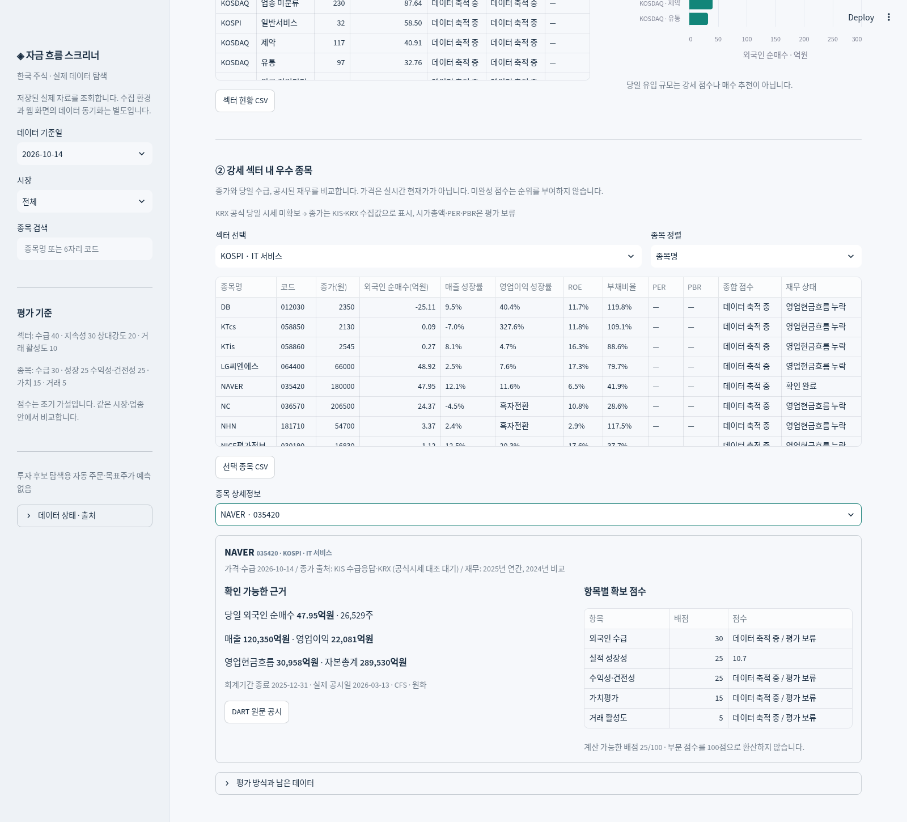

# 배포 준비 검증 — 2026-10-14

- GitHub `main`에 앱, 의존성, 설정, 실제 데이터 사본 업로드 완료.
- 원본 DB와 배포 DB의 SHA-256 일치. 실제 외국인 수급 2,430종목, 공시일 확인 재무 2,388종목.
- Python 3.12의 새 GitHub Actions 환경에서 의존성 설치, 테스트, HTTP 서버 확인 성공.
- 검증 실행: https://github.com/0baselabkim-debug/qweasd/actions/runs/38578920939
- 로컬 배포 사본에서 pytest 15개 통과. 로컬 `data/`와 `.env` 없이 포함된 snapshot으로 실행.
- Chromium에서 화면 표시, `KOSPI · IT 서비스` 선택, 종목명 정렬, NAVER 상세 정보의 47.95억원 표시, CSV 실제 다운로드 확인.
- 업로드할 코드·DB·설정에서 기존 환경의 인증키 값 일치 0건. API 키·토큰은 배포에 필요하지 않으며 GitHub Secrets는 기존 수집 환경에 남겨 둠.
- 기존 수집 워크플로·수집 코드 변경 없음. 전체 시장 재수집 없음.

## 아직 완료되지 않은 항목

Streamlit Community Cloud에 앱 생성 및 공개 URL 접속 검증은 완료하지 못했습니다. 현재 Codex 실행 환경에서 `share.streamlit.io`와 `docs.streamlit.io` 요청은 프록시 연결 오류가 발생하며, 사용자 Streamlit 계정의 로그인 세션이나 배포 도구도 제공되지 않았습니다. 제한을 우회하지 않았습니다.

공식 배포 절차는 Streamlit의 공개 문서 저장소 `streamlit/docs`의 `content/deploy/community-cloud/deploy-your-app/deploy.md`와 `get-started/connect-github.md`를 GitHub API로 확인했습니다. 배포 바로가기 매개변수는 설치된 Streamlit의 내장 Deploy 기능에서 확인했습니다.

[배포 준비 화면 열기](https://share.streamlit.io/deploy?repository=0baselabkim-debug%2Fqweasd&branch=main&mainModule=app.py) → GitHub 로그인·Authorize streamlit → Python 3.12 확인 → Secrets 비움 → Deploy. 주소가 자동 생성되기 전에는 대시보드 공개 URL을 확정할 수 없습니다.

## 실제 실행 화면

아래는 공개 배포 전, 동일한 파일로 실행한 로컬 Chromium 화면입니다.

