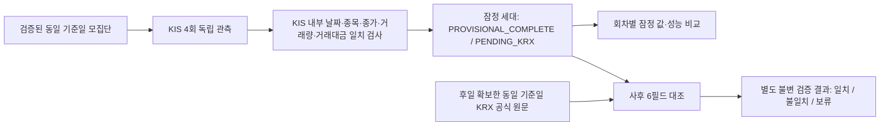

# KRX 빈 응답 조사와 잠정 수집·사후 검증 분리

이 문서는 2026-10-26 실험 중단 이후의 조사·오프라인 구현 결과다. 기존 실험·감시·관리 워크플로는 `disabled_manually` 상태를 유지한다. 실제 시장 API 호출, 재예약, 워크플로 재활성화는 이 작업에 포함하지 않는다.

## 1. 원인별 판단

| 가능성 | 확인한 근거 | 판단 |
|---|---|---|
| 당일 데이터 미게시 | 19:51~19:59 KST의 KOSPI 응답 6개가 빈 목록. 과거 날짜의 정상 수신 기록은 존재 | 가능하지만 **미확정**. 공식 게시 시각을 확인하지 못했으며 같은 시점의 정상 거래일 대조도 없다 |
| 이용 권한·서비스 승인 | 이번 응답은 HTTP 200. 과거 KOSPI·KOSDAQ 서비스 성공 기록 존재 | **미확정**. HTTP 200/빈 목록은 현재 키·서비스 승인 유효성을 증명하지 않는다. 과거 성공 당시 키와 현재 키가 같다는 증거도 없다 |
| 요청 방식·파라미터 | 실행 소스와 과거 성공 기록 모두 GET `/svc/apis/sto/stk_bydd_trd?basDd=YYYYMMDD`, 헤더 이름 `AUTH_KEY` | 동일 형식의 과거 호환성은 확인. 현행 공식 명세와의 최종 대조는 **BLOCKED** |
| 제공처 장애 | 실제 9개 물리 요청은 모두 200, KIS 지수 정상. KRX는 구조가 있는 빈 JSON | HTTP 5xx·연결 실패는 관측되지 않음. KRX 내부 데이터 공급 장애는 배제할 수 없고 공식 장애 공지도 확인하지 못함 |

**확정할 수 있는 수집기 측 원인:** 기존 `engine.plan()`은 KRX 시장자료를 KIS 종목별 요청보다 먼저 실행했다. KRX 빈 목록이 `REFERENCE_NOT_AVAILABLE`로 분류되면서 KIS 수급·가격 요청 전체가 시작되지 않았다. 빈 목록을 정상 시세로 승인하지 않은 검증은 유지하되, 이 선행 의존성을 분리했다.

## 2. 사고 실행과 증거 수준

- 대상 Run: `40311038702`, 기준일 `2026-10-26`, 최초 실제 처리 19:51:01~복구 종료 19:59:21 KST.
- 물리 HTTP 9회 = KIS 인증 1 + KIS 지수 2 + KRX KOSPI 6. 재시도 5회. 종목 수급·가격과 KRX KOSDAQ은 미실행.
- 실제 응답의 의미상 내용은 사용자 확인 및 이전 독립 Actions 검사에 따라 `{"OutBlock_1":[]}`다. 직렬화 공백 등을 포함한 원문 바이트를 새로 만들지 않는다.
- 보존 아티팩트 ID `12644378705`, ZIP SHA256 `466dcdb27bc838700643266b8d4f77f1110d124e02335d107904e9ea828a24a8`.
- 이전 독립 검사: manifest 파일 18개/원문 해시 3개/원장 9회 일치. DuckDB·JSON은 0행으로 일치. [기존 검사 영수증](../reports/krx-empty-20261026/prior-independent-audit.json)은 공개 Issue에서 읽기 전용으로 다시 확보했다.
- 이번에는 원본 ZIP 자체를 재다운로드하지 못했다. 로컬 GitHub API/로그인 필요 아티팩트 접근 제약이 있으며, 중단 워크플로를 재활성화하여 이를 보완하지 않았다. 따라서 **이번 작업에서 사고 ZIP 원문·실제 메타데이터를 새로 바이트 단위 검증한 상태는 아니다**.
- 실행 소스 고정 SHA `a9a8f05a2f98a0a3ffb551946b0d624c3f8246f8`의 KRX 경로는 `https://data-dbg.krx.co.kr/svc/apis/sto/stk_bydd_trd`, 파라미터는 `basDd=20261026`, 인증 헤더 이름은 `AUTH_KEY`다. 이는 실행된 코드의 요청 구성 확인이며 아티팩트 메타데이터 재다운로드를 대신했다고 주장하지 않는다.

원본 ZIP을 정상적으로 확보한 뒤 다음 **로컬 전용** 명령으로 재검증할 수 있다. 네트워크 호출 기능은 없다. ZIP 고정 해시, manifest, 9회 HTTP 200 원장, KRX 관측 6개의 요청 파라미터·응답 구조·원문 해시를 검사한다.

```bash
.venv/bin/python -m collector_v1.experiment.krx_diagnostics audit-local-archive \
  --archive /tmp/original-12644378705.zip --extract-to /tmp/krx-incident-audit
```

## 3. 과거 성공·공식 문서 대조

[과거 성공 비교 기록](../reports/krx-empty-20261026/historical-success-comparison.json)에 기존 보존 캐시의 파일 해시와 행 해시를 재검증했다.

| 기준일 | 시장 | 정상 행 | 요청 |
|---|---|---:|---|
| 2026-10-15 | KOSPI | 940 | `stk_bydd_trd?basDd=20261015` |
| 2026-10-15 | KOSDAQ | 1,822 | `ksq_bydd_trd?basDd=20261015` |

이는 당시 성공한 파싱 결과와 저장된 원문 SHA256 기록이다. 원문 응답 바이트를 캐시 JSON으로 재직렬화해 같은 해시라고 주장하지 않는다. 과거 종목 목록·시세를 10월 26일 자료로 대체하지 않는다.

공식 문서 URL `https://openapi.krx.co.kr/contents/OPP/MAIN/main/index.cmd`, `https://data-dbg.krx.co.kr/contents/OPP/MAIN/main/index.cmd` 접근은 이 환경의 프록시에서 `Tunnel connection failed: 403 Forbidden`으로 차단됐다. 기존 저장 공식 홈페이지도 상세 명세가 아니라 리다이렉트 HTML뿐이다. 게시 시각·권한별 빈 목록 반환 규칙·최신 파라미터 명세는 검증되지 않았으며, 우회하지 않았다. 기록: [문서 접근 상태](../reports/krx-empty-20261026/document-access.json).

## 4. 승인 후에만 가능한 두 요청 진단 계획

[기계 판독 계획](../reports/krx-empty-20261026/two-request-plan.json)은 `NOT_APPROVED_NOT_RUN`이다. 실행 코드는 제공하지 않으며 워크플로와 연결하지 않는다.

1. 동일한 기존 키/GET/헤더/경로로 정상 대조일 `20261015` KOSPI 1회.
2. 같은 조건에서 대상일 `20261026` KOSPI 1회.

최대 물리 HTTP 2회, 실패도 포함, 자동 재시도 0회, 동시 실행 0, 첫 인증·전송 오류에서 중단한다. 추가 인증 요청은 없다. 대조일 정상/대상일 빈 목록이면 날짜별 가용성 차이를 지지하지만, 공식 게시 지연이 유일한 원인임을 증명하지는 않는다. 둘 다 빈 목록이면 권한·요청 정책·미게시·장애를 구분할 수 없다. 서비스 승인 여부는 공급자 계정의 해당 서비스 상태와 정상 접근 가능한 공식 문서로 별도 확인해야 한다. 진단 시점이 사고 이후이므로 사고 당시 원인을 소급 확정할 수 없는 한계도 있다.

## 5. 분리 구조



### A. KIS 잠정 수집

`stages.collect_kis()`는 기존 `Providers`와 동일 endpoint·파라미터·1.05초 간격·토큰 재사용·실패 요청 회계·제한적 재시도를 사용한다. KRX 호출은 계획에서도 제외하고 예산 계층에서도 금지한다. 세 종목의 **KIS 내부** 검사를 먼저 통과해야 대규모 예산으로 승격한다.

- 외국인 순매수 수량·금액, 기관 순매수 수량·금액 원천값, 원주가 OHLCV·거래대금, 시장 지수를 보존한다.
- 수급 응답과 가격 응답의 종가·거래량·거래대금을 모두 비교하고 날짜·종목·기관 수량을 기존 규칙으로 검증한다.
- 종목별 수급/가격 실제 관측 시각과 각각의 원문·메타데이터 해시를 유지한다.
- `kis_validated`와 `kis_success_rate`는 내부 검증 성과다. 공식 `validated=0`, `official_accepted=0`, `official_price_status=PENDING_KRX`는 따로 유지한다.
- 기관 금액 원천값의 공식 단위가 미검증이면 원화 금액은 null로 유지한다. KRX 시가총액도 미확보 상태에서는 null이며 0으로 대체하지 않는다.

### B. KRX 사후 검증

`stages.validate_krx()`는 **오프라인 함수**다. 해시가 검증되는 기존 공식 API 원문 Store/메타데이터를 입력받으며, 자료가 없다고 API를 호출하거나 재시도하지 않는다.

- KIS 세대의 manifest, 원문/관측 메타데이터, 호출 원장 접두부, DuckDB/JSON을 검증하고 KIS 원문에서 값을 다시 산출한다.
- KRX 요청 시장·기준일·파라미터·endpoint, 반환 날짜·시장·중복·필수 정수값·OHLCV·시가총액을 검사한다.
- 시가·고가·저가·종가·거래량·거래대금의 **6개 필드 모두 정확히 일치**해야 `SIX_FIELD_MATCH`다. 불일치는 `kis`, `krx`, `delta`를 필드별로 기록한다.
- 빈 목록/누락은 `PENDING_KRX`, 잘못된 날짜·누락 종목·가격 불일치는 HOLD다. 해시 손상은 즉시 실패한다.
- 결과는 `attestations/<SHA256>.json`에 새로 보존한다. KIS 원문·세대·기존 불일치 기록은 수정하지 않는다.
- 모든 가격이 맞아도 `provider_finality=UNVERIFIED`, `flow_officially_verified=false`다. 가격 대조만으로 공급자 최종 확정이나 기관 금액 단위를 승인하지 않는다.

## 6. 호출 회계·복구·비교·성능 준비

- 고정 세션의 `kis/R1`~`R4`가 각각 신선한 KIS 응답을 수집한다. 같은 회차의 복구만 해시 검증 후 캐시를 재사용한다. 다른 회차 응답을 복사하지 않는다.
- 세션 전체 단일 잠금/append+fsync 호출 원장/원장 유실 시 중단/모집단·코드·회차별 설정 불일치 시 중단을 적용한다. 기존 실패 실험 root를 새 구조로 전용하지 않는다.
- 정상 기본 요청: KIS `2×2349+인증1+지수2=4,701`회/회차, 네 회차 18,804회. 후속 승인된 KRX 두 시장 2회를 합치면 18,806회다. 실제 재인증·실패·복구는 추가로 계상한다.
- 기존 제안 상한 5,600회/회차와 전체 22,400회를 확장하지 않는다. 새 KIS 공유 원장은 전체 상한 중 KRX 2회를 예약해 KIS 최대 22,398회를 허용한다. KRX 실제 요청 단계는 아직 연결하지 않았고, 향후 승인된 실행기에서 이 원장과 함께 제한해야 한다. 기존 pilot의 20회 제한은 유지한다.
- 불변 세대 ID는 원문/DB/보고서 해시 및 당시 원장 접두부를 묶는다. 복구로 원장이 추가돼도 이전 세대를 검증할 수 있다.
- `stage_analysis.compare_kis()`는 수급·OHLCV 값만 비교해 `PROVISIONAL_COMPLETE_MATCH`, `PARTIAL_MATCH`, `VALUES_CHANGED`, `NOT_COMPARABLE`로 분류한다. 관측 시각/원문 해시 차이는 값 변화로 취급하지 않고 null과 0은 구분한다. 시장·날짜·모집단·연속 회차가 달라지면 비교하지 않는다.
- 예약/실제 시작·완료·관측 시간, 전체 소요시간, API 및 실패 요청 수/실패율, 데이터 작업 실패 수, 재시도/복구 시간, 단계별 병목, 코드/설정 해시를 보고한다. KRX 사후 결과는 KIS 세대 ID로 결합한다.
- 네 회차 모의 검증은 실제 시간·성능 개선의 증거가 아니다. 실제 개선 효과는 승인 후 실측값으로 평가하며, 현재 검증되지 않은 성능 설정은 자동 적용하지 않는다.

## 7. 실행 차단과 재개 조건

현재 수집 함수는 transport를 명시하지 않으면 디렉터리 생성 전 `live_execution_requires_separate_approval_and_launcher`로 실패한다. 이번 테스트는 합성 transport만 주입한다. 기존 workflow나 `runtime run`을 새 구조로 몰래 전환하지 않았고, 새 live CLI·스케줄러도 만들지 않았다. 기존 3개 워크플로를 다시 활성화하면 과거 고정 SHA가 실행될 수 있으므로 재활성화하지 않는다.

재개에는 (1) 사용자 명시적 승인, (2) 실제 시험 기준일/4개 관측 시각·모집단·요청 예산 승인, (3) 새 단계와 상태를 이해하는 검증된 수동 실행기/제어 파일, (4) 공식 제공 범위와 KIS 소수 표본 실연결 확인, (5) 고정 아티팩트·공유 원장 복원, (6) KRX 원인 구분 및 사후 검증 입력 확보가 필요하다. 별도의 두 요청 진단도 실제 실행 승인이 필요하다.

## 8. 이번 작업 검증 결과

- 전체 오프라인 테스트 **499 passed**, 실패 0 (368.87초).
- 네 독립 KIS 세대 각각 2,349종목/4,701회 합성 요청을 검사했고, 같은 두 시장 KRX 원문으로 네 세대 모두를 사후 대조하는 확장 검사도 **1 passed** (28.35초). 이 숫자는 모의 호출이며 실제 API 요청이 아니다.
- 단일 모의 종목의 여섯 가격 필드를 각각 변경해 모든 불일치가 필드별 HOLD로 기록되는지 확인했다.
- 빈 KRX·잘못된 날짜/시장·원문/manifest 손상·원장 유실·인증/내부 일관성 실패·잠정/공식 상태 분리·null/0 구분·불완전 모집단의 성능 결론 차단을 검사했다.
- 기존 3종목/마스터/가격 검증 테스트도 모두 통과했다. 운영 snapshot 743개 파일, 기존 pilot, main, 워크플로/제어 파일과 예약 설정은 바꾸지 않았다.
- **이번 실제 시장 API 호출: 0회.** 기존 사고 누적 9회는 과거 이력으로 보존한다. 새 진단 계획도 미승인/미실행 상태다.

[기계 판독 종합 결과](../reports/krx-empty-20261026/investigation-result.json)와 이 기능 브랜치의 코드를 함께 검토할 수 있다. 원인 확정에는 아직 공식 정책/현재 서비스 승인 확인과 별도 승인된 제한 조회가 필요하다.
