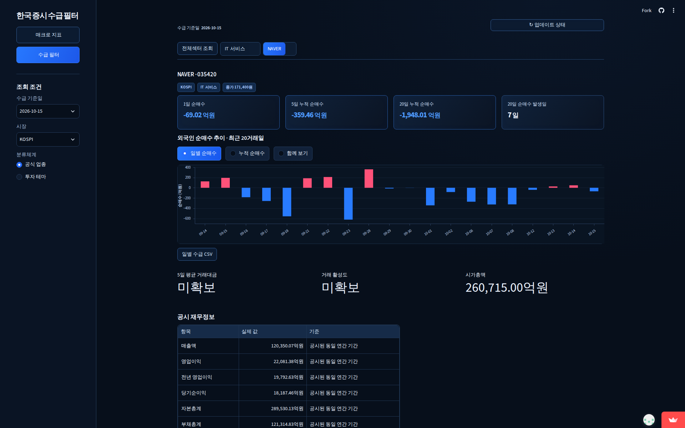
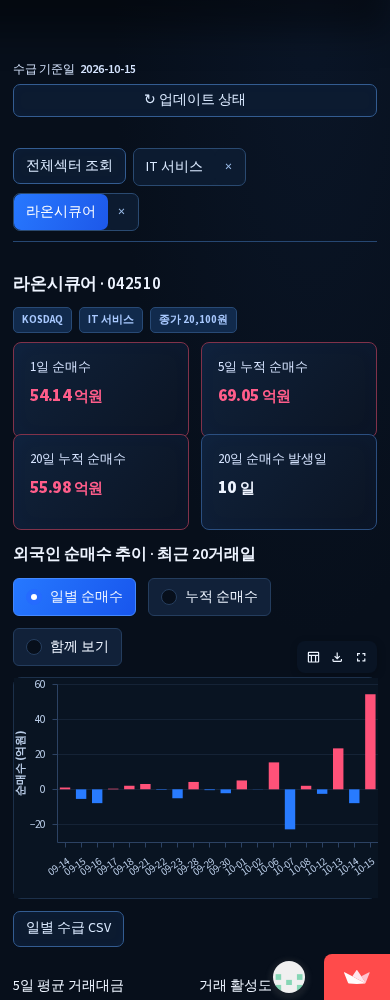

# 매수·매도 가이드 및 매매일지 제거 · 공개 데이터 경량화

기준일 **2026-10-15**, 대상 **2,430종목**. 최초 기준 `89e9920` 이후 자동 공시 게시 `a910644`를 보존했다. 변경 전 정상 거래 활성도는 과거 요청의 413/7보다 늘어난 **435종목·10섹터**였다. 아래 비교는 이 실제 시작 상태를 기준으로 한다.

## A. 제거 결과

| 항목 | 결과 |
|---|---|
| 매수·매도 가이드 UI | 제거. 매수/관망/손절/익절 자동 결론 없음 |
| 기술적 매매 계산 | SMA·일목·ATR·피벗·손익비·진입가·청산 코드 및 규칙 삭제 |
| 매매일지 | 메뉴·입력·보유종목·세션·로그인·백엔드 경로 제거 |
| Supabase 개인 거래 연동 | 실행 코드·SQL·전용 테스트·설정 안내 제거. 외부 데이터/키는 미접근·미삭제 |
| 매매 신호 전용 수집 | 320일 수집·기술 검증 워크플로 제거 |
| 투자 적격성 결론 | 제거. 공시 재무 수치와 미확보 사실은 유지 |
| 저장 데이터 | 활성 장기 기술 캐시 제거. 불변 원본은 해시 검증 후 비활성 압축 감사 보관소에 유지 |
| 코드·테스트 | 전용 테스트 삭제, 공공 자료의 예산·백오프·날짜 검증 테스트는 독립 모듈로 이전 |

[삭제 파일 목록](removed-files.json) · [삭제/이전/보존 분류](removal-categories.json) · [원본 보관 인벤토리](../../audit-archive/inventory.json)

## B. 보존 및 실제 복구

| 항목 | 결과 |
|---|---|
| 매크로 | 기존 지수·금리·환율·유가·VIX·CSV 유지. 시장 투자자 수급의 미확인 단위·범위는 계속 미확보 |
| 수급 필터 | 전체 종목, 1/5/20일 순매수·변화·지속·강도·확산율·정렬·검색 유지 |
| 업종·테마 | 기존 공식 업종·검증 테마 유지 |
| 거래 활성도 | 이관 직후 435/10 동일, 실제 추가 복구 후 437/10 |
| 재무·공시·사업 | 원본 수치·공시일·원문 링크·수정 이력 보존 |
| CSV | 기존 수급 값 및 정밀도 보존. 제거된 투자 적격성 결론 열만 제외 |
| 정규 자동 갱신 | 평일 20:30/23:30, 매크로·DART 유지. 독립 유동성 복구 예약 유지 |

이관 시 기존 유동성 증거 48건을 이전 전체 검증으로 확인한 후 25일 창으로 줄였다. 원본 해시·최신일 OHLCV 6필드·원주가·20일 수급 원응답·시장·단위·날짜·공식 관측일 검증을 유지한다. 160~320일 길이와 매매 조건은 거래 활성도의 조건으로 사용하지 않는다. 이는 가격 충돌을 자동 해소하는 조치가 아니다. 공급자 최종성 UNVERIFIED도 유지한다.

정규 원본 DB 8개 테이블과 기존 정상 지표, 이전 1,161종목 평가 결과가 동일함을 독립 비교했다. 새로 바뀐 수치는 실제 복구한 두 종목의 거래 활성도·평균 거래대금뿐이다. 섹터는 전체 구성종목의 겹치지 않는 5일/20일, 총 25거래일을 다시 독립 합산했다. 결측을 0으로 바꾸지 않았다.

| 실제 복구 종목 | 증거 날짜 | 거래 활성도(배) | 5일 평균 거래대금(원) |
|---|---|---:|---:|
| 삼천당제약 (000250) | 2026-10-14 | 1.534578576 | 41,454,196,170.0 |
| 중앙에너비스 (000440) | 2026-10-14 | 0.117386051 | 154,703,062.0 |

[동일 기준일 전후 비교](after-regression.json) · [복구 후 독립 검증](final-data-validation.json) · [후보 수락과 실제 게시 분리 기록](recovery-outcome.json)

## C. 경량화 실측

| 항목 | 변경 전 | 변경 후 |
|---|---:|---:|
| 현재 추적 파일 용량 | 504.9 MB | 267.6 MB |
| 활성 기술/유동성 자료 | 87.9 MB | 6.7 MB |
| 예약 워크플로 수 | 5 | 4 |
| 정상 거래 활성도 종목 | 435 | 437 |
| 완성 섹터 | 10/50 | 10/50 |
| 로컬 매크로 초기 화면 | 1.04초 | 0.73초 |
| 로컬 수급 필터 첫 계산 | 16.28초 | 13.47초 |
| 로컬 종목 상세 | 0.65초 | 0.57초 |

용량 약 47.0% 감소. 압축 원본 128.4 MB와 롤백 게시본을 포함한 수치다. Git 이력을 강제 재작성하지 않았으므로 `.git` 용량이나 clone 속도 감소를 주장하지 않는다. 추가 공시와 실제 복구 게시본도 포함했다. 시간은 같은 VM·Python의 별도 AppTest 프로세스에서 각 1회 측정했으며, 인터넷 왕복 시간·다중 사용자 성능 또는 통계적 평균이 아니다.

독립 복구 실제 표본: **2/2 검증·게시**, KIS **7회**(인증 1회 포함), KRX **2회**, 재시도·오류 0, 복구 단계 **12.17초**. 설치·65초 인증 간격 대기·게시 시간은 별도다. 이번 표본은 과거 날짜의 3개 조회가 필요한 경우이므로 종목당 HTTP 요청이 이전 동일 유형보다 줄었다고 주장하지 않는다. 실제 절감은 제거된 장기 일봉 유지·매매 계산 경로이며, 향후 하루 전체 요청 절감률은 아직 실측하지 않았다. 정상 정규 수집 요청 자체는 줄이지 않았다.

비교 가능한 이전 실행 38856339494도 신규 조회한 과거 날짜 2건에 인증 포함 7회였다(나머지 4건은 저장 증거 재사용). [이전 실측](old-comparable-api-sample.json). 새 게시 자료로 동일 두 종목을 재처리하면 KIS/KRX/토큰 발급 모두 0회임을 실제 DB로 확인했다([결과](actual-cache-recheck.json)). 압축 보관 원본 7,317개, 423,193,788바이트의 SHA256도 모두 일치했다([검증](archive-verification.json)).

## D. 테스트·배포 근거

- 로컬 전체 회귀: **153개 통과** — [로그](pytest-release.txt).
- 최종 검증 코드 CI: [38863075662](https://github.com/0baselabkim-debug/qweasd/actions/runs/38863075662) — `17e50e5ae196bcb4f12347aa6d3603cf001df43a`, 성공.
- 실제 수급 복구: [38861222096](https://github.com/0baselabkim-debug/qweasd/actions/runs/38861222096) — **workflow_dispatch**. 이를 schedule 성공이라고 부르지 않는다.
- 공개 PC·모바일 브라우저: [38863072839](https://github.com/0baselabkim-debug/qweasd/actions/runs/38863072839) — 성공. [실제 빌드·자료 해시와 CSV 검사](public-browser/result.json).
- 1920/1440/768/390 화면, 두 메뉴, 매크로·시장/기간/정렬/검색·섹터/종목/상세·차트·탭 닫기·재무/테마·CSV 확인. 18개 표본 탐색 및 913종목 CSV의 거래 활성도·평균 거래대금을 원본과 대조했다. 신규 복구 두 종목과 완성 섹터 10개가 포함된다.

첫 CI는 새 체크아웃에 이전 정상 게시본이 빠진 문제가 있었고 `dcfd2ad`로 추가했다. 첫 공개 웹에서는 Streamlit 메모리에 남은 옛 검증 함수가 삭제된 규칙 파일을 찾는 오류가 확인됐다. `96f634d`에서 검증 모듈을 의존 순서로 다시 로드하도록 수정하고 재현 테스트를 추가했다. 이후 모바일 제목 검사와 과거 조회 검사에도 제거 전 문구·반복문 종목 변수를 사용하던 테스트 오류가 있어 수정했다. 후자는 실제 선택된 000440의 과거 CSV 20행이 원본과 일치함을 별도로 확인했다. 실패 실행을 성공으로 합산하지 않았다. 중간 웹 검증 38861847082는 신규 복구 두 종목을 포함한 최종 검증으로 교체하기 위해 취소했다.

주요 구현: [앱](../../app.py), [유동성 수락 검증](../../screener/liquidity_quality.py), [공공 데이터 검증](../../screener/market_validation.py), [독립 복구](../../scripts/recover_liquidity.py), [일관된 게시](../../scripts/publish_liquidity.py), [예약](../../.github/workflows/liquidity-recovery.yml).

## 남은 사항과 사용자 조치

- 새 독립 예약의 설정·한도·직렬화·재시도와 수동 실데이터 실행은 검증했다. 아직 실행되지 않은 새 schedule 이벤트나 10/16 20:30·23:30 신규 거래일 성공은 확인 완료로 보고하지 않는다.
- 거래 활성도는 1,993종목과 40개 섹터에서 계속 미완성이다. 원본 가격 충돌·날짜별 증거·누락 자료가 남는다. 가이드 제거를 이유로 이를 정상 처리하지 않았다. 기존 날짜별 큐와 백오프로 이어간다.
- 시장 전체 투자자별 수급의 단위·시장 범위 미확보, 일부 재무 정정 자료의 근거 부족은 그대로다. 자동 적격성 결론은 제거했고 객관적 미확보 사실만 제공한다.
- 외부 개인 저장소에는 접근하지 않았다. 앱 이용에 추가 설정은 필요 없다. 과거 Supabase를 실제 사용했다면 기록 보관 여부를 정한 후 사용자가 전용 키와 프로젝트를 정리할 수 있다. [메뉴 순서](../../docs/public-data-operations.md). KIS·KRX·DART 등 공개 데이터 키는 유지한다.

**공개 앱:** https://0baselabkim-debug-qweasd-app-nuf4kg.streamlit.app/

